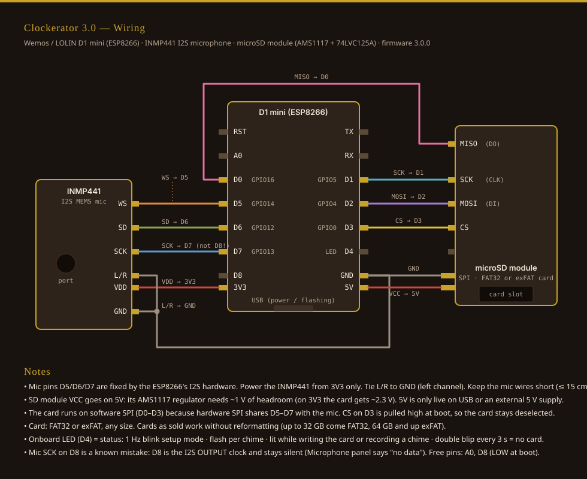

# Clockerator 3.0

**A chime monitor for a grandfather clock.** An ESP8266 (Wemos D1 mini) with an
INMP441 digital microphone and a microSD card listens to the clock. It does the following:

- detects every strike and logs its time to the millisecond, along with its loudness in dB SPL and its pitch;
- groups strikes into **chime events**, e.g. "7 strikes at 07:00:01";
- **records every chime as a WAV file** and plays it back on its web dashboard;
- shows a live spectrum and spectrogram of what the microphone hears;
- logs the room's sound level every second, in CSV files that open in Excel.



> **Status:** the firmware (3.0.0) compiles cleanly and its dashboard and
> signal processing were tested off-device, but it has **not yet run on the
> real board**. Follow the [bring-up checklist](#first-power-up-checklist) the
> first time.

---

## Contents

- [Parts list](#parts-list)
- [The three modules](#the-three-modules)
- [Wiring](#wiring)
- [Why these pins](#why-these-pins)
- [Power](#power)
- [Building it on perfboard](#building-it-on-perfboard)
- [Placing it in the clock](#placing-it-in-the-clock)
- [Software setup](#software-setup)
- [First power-up checklist](#first-power-up-checklist)
- [Status LED](#status-led)
- [Files on the SD card](#files-on-the-sd-card)
- [Troubleshooting](#troubleshooting)
- [Repository layout](#repository-layout)

---

## Parts list

| Qty | Part | Notes |
|---|---|---|
| 1 | **Wemos / LOLIN D1 mini** (ESP8266, 4 MB flash) | Clones are fine (this build uses one with an ESP8266MOD module). USB serial is on the board, so no programmer is needed. Sometimes sold as a "NodeMCU". |
| 1 | **INMP441 I2S MEMS microphone** breakout | The common round board with six pins: `SD VDD GND SCK WS L/R`. |
| 1 | **microSD card module, SPI** | The common module with an **AMS1117-3.3** regulator and a **74LVC125A** buffer chip, and a header `GND VCC MISO MOSI SCK CS`. |
| 1 | **microSD card, any size** | **FAT32** or **exFAT**, so cards work as sold: up to 32 GB they come FAT32, 64 GB and up exFAT. 8–32 GB is plenty (see [Files on the SD card](#files-on-the-sd-card)). A decent-brand card writes faster and stalls less. |
| 1 | 5×7 cm perfboard | Or any protoboard. |
| – | Hookup wire, female headers / sockets | Socketing the D1 mini and the modules lets them be swapped. |
| 1 | USB cable + **5 V USB power supply, 1 A or more** | Any phone charger. The SD module needs the 5 V that only USB (or an external 5 V supply) provides. |
| opt. | 100 µF electrolytic capacitor | Across 5V–GND near the SD module, if the card ever resets during writes (see [Power](#power)). |
| opt. | Soft foam / rubber grommets | To mount the mic without it touching the case (see [Placing it in the clock](#placing-it-in-the-clock)). |

---

## The three modules

### Wemos / LOLIN D1 mini (ESP8266)

- 3.3 V logic. **No pin is 5 V tolerant.** Its on-board regulator makes 3.3 V from
  the USB 5 V.
- Two rows of 8 pins:
  `RST A0 D0 D5 D6 D7 D8 3V3` and `TX RX D1 D2 D3 D4 G 5V`.
  **Go by the printed labels, not by position**, because clones differ.
- `D4` is the on-board blue LED (lit when the pin is LOW). The firmware uses it as the status light.
- Arduino board name: **LOLIN(WEMOS) D1 R2 & mini** (`esp8266:esp8266:d1_mini`).

### INMP441 microphone

A calibrated digital MEMS microphone. It sends audio over I2S, so there is no gain to
set and no analog noise to fight.

| Spec (datasheet) | Value |
|---|---|
| Interface | I2S, 24-bit, two's complement, MSB first |
| Sensitivity | −26 dBFS for 94 dB SPL (1 Pa), ±1 dB |
| Signal-to-noise | 61 dBA (self-noise ≈ 33 dB SPL) |
| Frequency response | about 60 Hz – 15 kHz |
| Max sound level | 120 dB SPL |
| Supply | 1.8 – 3.3 V, about 1.4 mA |

| Pin | Meaning |
|---|---|
| `SD` | serial data out (the audio) |
| `SCK` | bit clock, **driven by the ESP8266** |
| `WS` | word select / L-R clock, **driven by the ESP8266** |
| `L/R` | channel select: to GND = the mic talks in the **left** slot |
| `VDD` | **3.3 V only** |
| `GND` | ground |

The INMP441 is a **bottom-port** microphone: sound reaches it through the small
hole in the breakout board. Keep that hole uncovered and pointing at the clock's
chime rods or gong.

### microSD card module

- The **AMS1117-3.3** regulator turns the module's `VCC` into 3.3 V for the card. It
  needs about 1 V of headroom, so **`VCC` must be 5 V**. Fed from 3.3 V, the card
  gets only about 2.3 V and fails or corrupts writes.
- The **74LVC125A** buffer runs from the module's 3.3 V. Its outputs (including
  `MISO`, back to the ESP) are 3.3 V logic, and it accepts the ESP's 3.3 V signals.
  No level shifters are needed.
- Header: `GND VCC MISO MOSI SCK CS`.

---

## Wiring

13 connections in total. **This table is the reference**; the
[diagram](Clockerator/wiring_diagram.svg) and `Clockerator/config.h` match it.

### microSD module → D1 mini

| Module pin | D1 mini pin | ESP8266 GPIO | Notes |
|---|---|---|---|
| `VCC` | **`5V`** | – | **Not 3V3** (see above). |
| `GND` | `G` | – | |
| `CS` | `D3` | GPIO0 | Boot pin, must be HIGH at boot. CS idles HIGH, so this is safe. |
| `SCK` | `D1` | GPIO5 | Software (bit-banged) SPI. |
| `MOSI` | `D2` | GPIO4 | Software SPI. |
| `MISO` | `D0` | GPIO16 | Software SPI. Must **not** be on D3, D4 or D8 (boot pins). |

### INMP441 microphone → D1 mini

| Mic pin | D1 mini pin | ESP8266 GPIO | Notes |
|---|---|---|---|
| `VDD` | **`3V3`** | – | Never 5 V. |
| `GND` | `G` | – | |
| `L/R` | `G` | – | Selects the left channel. Don't leave it floating. |
| `WS` | `D5` | GPIO14 | I2S input word select. Fixed in silicon. |
| `SD` | `D6` | GPIO12 | I2S input data. Fixed in silicon. |
| `SCK` | **`D7`** | GPIO13 | I2S input bit clock. Fixed in silicon. **Not D8!** |

> ⚠️ **The most likely wiring mistake is mic `SCK` on `D8`.** D8 (GPIO15) is the
> I2S *output* clock and stays silent while the board receives, so the mic gets
> no clock and sends nothing. The dashboard's Microphone panel then reports
> **"no data"**. Move the wire to **D7**. (This board was first soldered that
> way, so check it first.)

### Pins left free

| Pin | Notes |
|---|---|
| `A0` | Free (analog in, 0–1 V on the bare chip, 0–3.2 V via the D1 mini's divider). |
| `D8` (GPIO15) | Free, but **must be LOW at boot** (the board has a pull-down). Don't attach anything with a pull-up. |
| `D4` (GPIO2) | On-board LED (status). Must be HIGH at boot. |
| `TX`, `RX` | USB serial (uploading and the serial monitor). Leave alone. |
| `RST` | Reset. |

### Don'ts

- Don't put mic `SCK` on D8, or SD `MISO` on D3, D4 or D8.
- Don't power the SD module from 3V3, or the mic from 5V.
- Don't put 5 V on any GPIO.
- Don't move the SD card onto D5–D8 (see below).
- Don't use RX/TX for peripherals.

---

## Why these pins

**The microphone's pins are not a choice.** The ESP8266 has no pin multiplexer:
its I2S *receiver* exists only on **GPIO14 (WS), GPIO12 (data) and GPIO13
(bit clock)** = D5, D6, D7.

**Those are also the hardware SPI pins** (GPIO12 = MISO, 13 = MOSI, 14 = SCK).
So the SD card can't use hardware SPI. It runs on **software SPI on D0–D3**:
the firmware toggles the pins directly through the GPIO registers. That is ample
for the logs and for recording (about 20 KB/s is needed). The dashboard has a
**Speed test** button that measures your card.

**Boot strapping pins.** The ESP8266 reads three pins at power-up to decide
how to boot:

| GPIO | D1 mini | Must be at boot | What is on it here |
|---|---|---|---|
| GPIO0 | D3 | HIGH | SD `CS`: idles HIGH (and the board's pull-up keeps the card deselected) |
| GPIO2 | D4 | HIGH | on-board LED |
| GPIO15 | D8 | LOW | nothing |

`MISO` is the one SD line the *card* drives, so it must not sit on a boot pin,
where a card could hold the pin at the wrong level and stop the board from
booting. That is why it goes on **D0** (GPIO16), which has no boot role.
(GPIO16 is read through a separate register; the firmware handles that.)

**The ESP8266 can't give the mic the clock it asks for.** The INMP441 wants 64
bit clocks per left/right frame. The ESP8266's I2S can produce 32 or 48, never 64.
At 32 clocks the mic most likely delivers a new sample every *other* frame. The
firmware is built around that: it samples frames at 20 kHz and uses them
averaged in pairs as 10 kHz audio (5 kHz bandwidth, plenty for chimes). The
Microphone panel's **"repeats"** figure shows what your mic actually does
(about 50 % = each value sent twice, as expected). Details are in
[HANDOFF.md §6](Clockerator/HANDOFF.md#6-how-the-audio-works).

---

## Power

- Power the board through the **D1 mini's micro-USB** from a **5 V, ≥ 1 A**
  supply, or feed 5 V into the `5V` pin from a regulated supply (not both at once).
- From the 5 V rail: the D1 mini's regulator makes 3.3 V for the ESP8266 and the
  microphone, and the SD module takes 5 V directly.

| Load | Typical draw |
|---|---|
| ESP8266 with WiFi | ~70–80 mA average, short peaks of ~170 mA or more while transmitting |
| microSD card | tens of mA, up to ~100 mA during writes |
| INMP441 | ~1.4 mA |
| **Whole device** | **under ~0.4 A peak** |

- **Battery:** not a design goal. The SD module needs a real 5 V. A USB power
  bank works, but some banks switch off at low loads.
- If the SD card fails *during writes* but works on the speed test, the supply
  or cable is sagging. Use a shorter/thicker USB cable, a better charger, or
  add a **100 µF capacitor across 5V–GND** near the SD module.

---

## Building it on perfboard

The prototype fits on a **5×7 cm** board.

1. **Socket the D1 mini** with female headers (and the modules too, if you
   like) so parts can be swapped.
2. Run a **ground bus** first. Every module's `GND`, plus mic `L/R`, goes to the
   D1 mini's `G`.
3. Wire **5V → SD VCC** and **3V3 → mic VDD**. Double-check these two before
   anything else.
4. Wire the **three mic signals** (D5/D6/D7). Keep them short (≤ 15 cm) and
   away from the SD lines. If the mic must sit away from the board, use a short
   cable and keep `GND` alongside the signals.
5. Wire the **four SD signals** (D0–D3).
6. **Before plugging in USB**, check with a multimeter (continuity mode):
   - no continuity between **5V**, **3V3** and **GND**;
   - mic `SCK` reaches **D7**, not D8;
   - SD `MISO` reaches **D0**;
   - mic `L/R` reaches GND.
7. Insert a **FAT32 or exFAT** card and connect USB.

Wiring diagram source: [`Clockerator/wiring_diagram.svg`](Clockerator/wiring_diagram.svg).

---

## Placing it in the clock

- Put the **microphone near the chime rods or gong**, with its hole facing
  them, about 10–30 cm away. Closer gives louder chimes and a better margin
  over room noise, but don't let a strike clip (the dashboard warns of clipping
  near 120 dB SPL).
- **Don't let the mic touch the case or the movement.** Wood and metal carry
  the tick and every bump straight into it. Hang it on its wires, or mount it
  in soft foam or a rubber grommet.
- Keep the D1 mini where **WiFi** reaches; a wooden case is usually fine.
- Leave the **SD card** reachable, and the **LED** visible if you want to see
  the status codes.
- Once it is in place, set the detection **threshold** on the dashboard to
  about two thirds of your quietest strike's peak. Use **Record 10 s test
  clip** to hear what the mic hears.

---

## Software setup

Everything ships with the ESP8266 Arduino core; **no extra libraries** are
needed.

1. **Arduino IDE** → Boards Manager → install **esp8266** by ESP8266 Community,
   **version 3.1.0 or newer** (3.1.2 tested).
2. Open **`Clockerator/Clockerator.ino`**. The folder must stay named
   `Clockerator`, and `Clockerator.ino.globals.h` must stay next to it (it
   configures the SD library).
3. Tools menu:
   - **Board:** LOLIN(WEMOS) D1 R2 & mini
   - **Flash Size:** 4MB (FS:2MB OTA:~1019KB) (any option with FS space)
   - **CPU Frequency:** 160 MHz (recommended; 80 MHz works)
4. Upload over USB. Later updates can go over WiFi: browse to
   `http://clockerator.local/update` and upload the `.bin` from
   *Sketch → Export Compiled Binary*.
5. **WiFi setup:** on first boot the board makes an open network called
   **`Clockerator-Setup`**. Join it, open **http://192.168.4.1**, pick your
   network and enter the password. (iPhone: turn off cellular data while doing
   this.) It reboots and joins your WiFi.
6. **Dashboard:** **http://clockerator.local**, or the IP address printed on the
   serial monitor at 115200 baud.

Command-line build:
`arduino-cli compile --fqbn esp8266:esp8266:d1_mini:eesz=4M2M,xtal=160 Clockerator`

---

## First power-up checklist

Stop at each step until it passes.

1. **Serial monitor (115200 baud).** Look for `[Clockerator] v3.0.0 booting`,
   `[SD] mounted: …` and `[MIC] I2S receive at 20000.0 Hz frames, audio 10000.0 Hz`.
2. **SD card panel:** green *"Logging to the SD card"*. Press **Speed test**.
   Recording needs about 20 KB/s; the test reports write and read speed and the
   slowest single write.
3. **Microphone panel:** *"Listening"*, about 35–45 dB in a quiet room, jumping
   when you talk or clap. While there is sound, note **repeats** (about 50 % expected).
4. **Spectrum panel:** press **Listen** and whistle. The peak should follow your
   pitch.
5. **Chime events panel:** press **Record 10 s test clip**. It plays back when
   done. It should sound natural, not sped up or slowed down.
6. Let the clock strike, then tune **Threshold** in *Detection tuning*. It goes
   up to 120 dB, the microphone's limit, for a mic mounted close to the gongs.
7. Optional: teach it the chime's pitch so other noises are ignored. Either
   press **Learn chime** and let the clock strike, or play a recorded event
   under *Chime events* and press **Learn chime from this**. Then turn the
   **Tone filter** on.
8. Once it's tuned, **Device → Delete all data** clears the test strikes and
   recordings so the logs start clean. Settings, WiFi and the learned chime
   are kept.

---

## Status LED

The on-board LED (D4):

| Pattern | Meaning |
|---|---|
| slow blink (1 Hz) | setup mode: join `Clockerator-Setup` |
| fast blink | joining WiFi |
| brief flash | a strike was detected |
| steady on | writing to the SD card or recording a chime: **don't pull the card** |
| double blip every 3 s | **not logging**: no card, or a card error |

---

## Files on the SD card

All folders are created automatically. The CSV files open directly in Excel,
and the dashboard can also export them as `.xlsx`.

| Path | Contents |
|---|---|
| `/chimes/YYYY-MM.csv` | one row per strike: date, time, epoch ms, seconds from the hour, peak Pa, peak dB, pitch Hz, strike number within its event |
| `/events/YYYY-MM.csv` | one row per chime event: time, strikes, duration, loudest dB, pitch, recording file |
| `/recordings/YYYY-MM-DD/HH-MM-SS.wav` | sound of each chime event (16-bit mono, 10 kHz, ~20 KB/s). Test clips end in `_test`. |
| `/levels/YYYY-MM/YYYY-MM-DD.csv` | loudest and average sound level, every second |
| `/system.csv` | boots, card mounts, WiFi drops, microphone status |

Recordings take roughly 10–40 MB a day, depending on how often the clock
chimes, so a 32 GB card lasts years. The device only deletes files when you
ask it to (it asks first, and neither can be undone):

- **✕ on an event** in *Chime events* deletes that one event: its row in the
  event log, its strikes in the chime log and its recording, and takes its
  strikes off the count. Use it for a false detection, like a door slam. The
  list shows events since the device started; **Load history** adds this
  month's and last month's, so they can be deleted too. The recording is kept
  if another event uses the same clip (this can happen with a test clip).
- **Device → Delete all data** removes every log and recording. To keep
  some, copy them off the card on a PC first.

**Without a card** the Clockerator still runs: it detects and counts strikes,
measures pitch, groups events, and the whole live dashboard works (WiFi and
settings live in the D1 mini's own flash). It just saves nothing: no logs and
no recordings. The SD panel says so and shows when it will look for a card
next. It tries a few times 30 s apart, then every 5 minutes. After putting a
card in, press **Check now** in the SD panel to start logging straight away
(no reboot needed). The most recent strikes (up to 48) are held in memory
meanwhile and written once the card is found.

---

## Troubleshooting

| Symptom | Likely cause | Fix |
|---|---|---|
| Microphone panel: **"no data"** | mic gets no clock or no power | Mic `SCK` on **D7** (not D8), `WS` on D5, `SD` on D6, `VDD` on 3V3, `L/R` and `GND` to G. |
| Microphone panel: **"clipping"** with no sound | floating data line | Check `SD` → D6 and `SCK` → D7 solder joints. |
| Microphone panel: **"too quiet"** (< 25 dB) | data misaligned, or the wrong half-word | Try the *Channel* selector (low/high half), then recheck the wiring. |
| Recordings sound sped up or slowed down | the mic isn't doubling samples as assumed | Note the **repeats %** and see [HANDOFF.md §6](Clockerator/HANDOFF.md#6-how-the-audio-works). |
| SD panel: *"no card, or card not answering"* | power or wiring | SD `VCC` on **5V** (on USB power), `CS` D3, `SCK` D1, `MOSI` D2, `MISO` D0. Reseat the card, then press **Check now**. |
| SD panel: *"card found but not readable"* | card format (e.g. NTFS) or a corrupt file system | Reformat as FAT32 or exFAT (the SD Association's *SD Card Formatter* is the safest tool). |
| Writes fail now and then | supply sagging, or a slow/old card | Better USB supply or cable, 100 µF across 5V–GND, a different card. Check **Speed test**. |
| Board won't boot or upload with the modules attached | something holding a boot pin | D3/D4 must be HIGH and D8 LOW at boot. Check nothing extra is on D3/D4/D8 and that `MISO` isn't on them. |
| Chimes counted twice | a ringing strike re-triggering | Raise **Onset rise** or **Refractory** in *Detection tuning*. |
| Soft strikes missed | threshold or rise too strict | Lower **Threshold**, then **Onset rise**. |
| `clockerator.local` doesn't open | mDNS not supported (some Android phones) | Use the IP address from the serial monitor or your router. |
| The page looks frozen after a firmware update | cached old page | Hard-refresh (Ctrl+Shift+R). |

---

## Repository layout

```
README.md                 this file: hardware, wiring, setup
Clockerator/              the Arduino sketch (open Clockerator.ino)
  Clockerator.ino         WiFi, web server + HTTP API, main loop
  Clockerator.ino.globals.h  build-wide SdFat option (software-SPI driver)
  config.h                pins, tunables, version history
  sound.*                 I2S microphone, audio ring, strike detection
  analysis.*              FFT: strike pitch, live spectrum, tone filter
  events.*                strikes grouped into chime events
  recorder.*              WAV recording to the SD card
  sdcard.*                software SPI driver, CSV logs, file serving
  settings.*, storage.*   settings in flash, time formatting
  webpages.h              setup page + dashboard (HTML/JS)
  wiring_diagram.svg      the wiring diagram above
  HANDOFF.md              developer notes: audio pipeline, API, design rules
```

For how the firmware works inside (audio pipeline, detection, HTTP API, what
is and isn't verified), see **[Clockerator/HANDOFF.md](Clockerator/HANDOFF.md)**.
